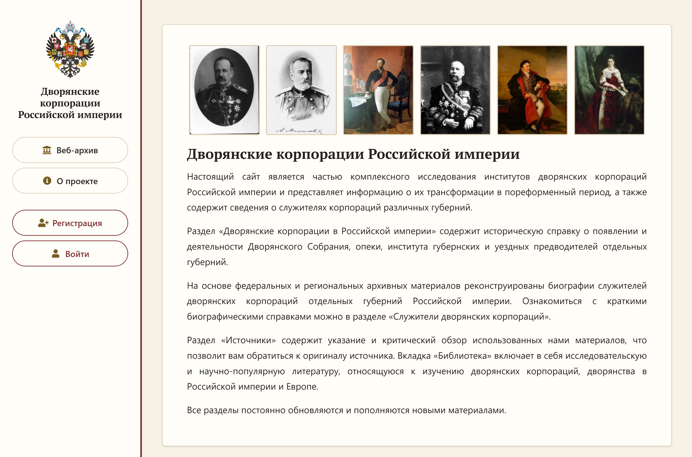

# Дворянские корпорации Российской империи — веб-архив

**[nobilityarchive.ru](https://nobilityarchive.ru/)** — научно-исследовательский веб-архив,
посвящённый институтам дворянских корпораций Российской империи и людям, которые в них служили:
от губернского предводителя до канцелярского служителя.

> **Это публичная витрина проекта.** Исходный код сайта защищён авторским правом и хранится
> в закрытом репозитории. Здесь опубликованы описание проекта, его архитектуры и технических
> решений, схема базы данных, сведения об авторах и научные публикации по проекту.

## О проекте

Изучение региональных дворянских обществ активно развивается с конца XX века, однако
комплексного представления о **служителях дворянских корпораций** и их роли в системе
сословного и государственного управления второй половины XIX — начала XX века до сих пор нет.
Интернет-ресурсов, посвящённых истории дворянских корпораций и содержащих биографические
материалы об их служителях, на момент запуска проекта не существовало.

Проект «Дворянские корпорации Российской империи» восполняет этот пробел:

- реконструирует биографии служителей дворянских корпораций по федеральным и региональным
  архивным материалам — прежде всего по **формулярным спискам о службе**;
- публикует их в открытом доступе в виде wiki-подобных персональных страниц
  со ссылками на источники;
- систематизирует архивные фонды и научную литературу по истории дворянского сословия;
- даёт исследователям материал для **просопографических исследований**.

Подробнее — в [docs/research.md](docs/research.md).

## Разделы веб-архива

| Раздел | Содержание | Доступ |
|---|---|---|
| **Дворянские корпорации в Российской империи** | Историческая справка о Дворянском собрании, опеке, институте губернских и уездных предводителей отдельных губерний | в разработке |
| **Служители дворянских корпораций** | Биографические справки (на момент публикации статьи — 777 справок по Самарской, Санкт-Петербургской, Саратовской, Ставропольской и Владимирской губерниям). Группировка по регионам, поиск по имени | открыт; часть полей — только редакторам |
| **Источники** | Архивные фонды: место хранения и характеристика, в т.ч. сведения о сохранности формулярных списков | открыт |
| **Библиотека** | Литература и информационные ресурсы по дворянской тематике, классифицированные по 19 направлениям проблематики | открыт |

Сайт адаптирован под мобильные устройства.

## Технологии

| Слой | Решение |
|---|---|
| Язык и фреймворк | Python 3.13, Django 5.2 (схема «модель — представление — шаблон») |
| База данных | MySQL на хостинге (драйвер PyMySQL), PostgreSQL при локальной разработке; СУБД выбирается через переменные окружения |
| Интерфейс | Шаблонизатор Django (DTL), HTML, CSS, Bootstrap 5.3, Font Awesome, шрифт PT Serif; без JS-фреймворков |
| Сервер | uWSGI на виртуальном хостинге «Спринтхост» (1 ядро, 512 МБ ОЗУ, 1 ГБ диска) |
| Тесты | Встроенный тестовый фреймворк Django, 33 автотеста |
| Выпуск | Git → GitHub (приватный репозиторий) → сервер; сценарий `deploy.sh` |
| Среда разработки | PyCharm |

## Документация

- [Архитектура](docs/architecture.md) — приложения Django, маршруты, роли и права доступа, безопасность, тесты
- [База данных](docs/database.md) — предметная модель, ER-диаграммы, принятые решения по хранению архивных данных
- [Развёртывание](docs/deployment.md) — инфраструктура, порядок выпуска и отката
- [Научная часть](docs/research.md) — исследовательский контекст, источниковая база, публикации
- [Статья о проекте](docs/article/README.md) — текст статьи в «Исторической информатике» (2026, № 4) с иллюстрациями
- [Правовая охрана](docs/licenses/README.md) — свидетельства Роспатента о регистрации базы данных и программы

## Авторы

| | Роль в проекте | О себе |
|---|---|---|
| **Екатерина Баринова** | Историк | Профессор кафедры отечественной истории и историографии Самарского национального исследовательского университета имени академика С. П. Королёва. Научные интересы: социальная история России XIX–XX вв., история дворянского сословия, повседневность, цифровая история |
| **Игорь Трубицын** | Историк | Доцент кафедры истории, философии и военно-патриотического воспитания Тольяттинского государственного университета. Научные интересы: социальная история России XIX–XX вв., история дворянских корпораций в России |
| **Дмитрий Логинов** ([@nmkyt](https://github.com/nmkyt)) | Разработчик | Бакалавр информационных технологий. Научные интересы: разработка и проектирование программного обеспечения с использованием технологий машинного обучения |

## Как сослаться

Метаданные для цитирования — в [CITATION.cff](CITATION.cff) (GitHub показывает кнопку
«Cite this repository»).

Если вы используете материалы веб-архива, ссылайтесь на сайт:

> Баринова Е., Логинов Д., Трубицын И. Дворянские корпорации Российской империи : веб-архив
> [Электронный ресурс]. — URL: https://nobilityarchive.ru/

Научное описание проекта опубликовано в статье:

> Трубицын И. О., Баринова Е. П., Логинов Д. В. Дворянские корпорации Российской империи:
> опыт создания исторического интернет-ресурса // Историческая информатика. — 2026. — № 4. —
> С. 18–31. — DOI: [10.7256/2585-7797.2026.4.82471](https://doi.org/10.7256/2585-7797.2026.4.82471).

## Обратная связь

Сайт развивается и пополняется. Если вы заметили опечатку, неточность в биографической справке
или хотите поделиться сведениями о служителях дворянских корпораций — создайте
[issue](https://github.com/nmkyt/NobilityArchive-Public/issues) в этом репозитории или напишите
на почту, указанную на сайте (см. страницу [«О проекте»](https://nobilityarchive.ru/about/)).

## Правовой статус

© Трубицын И. О., Баринова Е. П., Логинов Д. В. Все права защищены.

Проект «Дворянские корпорации Российской империи» —
[nobilityarchive.ru](https://nobilityarchive.ru/).

Зарегистрированные результаты интеллектуальной деятельности:

- база данных «Служители дворянских корпораций Российской империи» —
  свидетельство о государственной регистрации № 2025622686 от 23.06.2025;
- программа для ЭВМ «Nobility Archive» —
  свидетельство о государственной регистрации № 2025666170 от 24.06.2025.

Авторы и правообладатели — Трубицын И. О., Баринова Е. П., Логинов Д. В.
Копии свидетельств — в [docs/licenses](docs/licenses/).

Текст статьи, опубликованной в «Исторической информатике», распространяется
по лицензии [CC BY-NC 4.0](https://creativecommons.org/licenses/by-nc/4.0/).

Остальные материалы этого репозитория (тексты, схемы, иллюстрации) могут
цитироваться в научных и образовательных целях со ссылкой на проект.
Использование в иных целях — по согласованию с авторами.

Исходный код сайта не публикуется.
