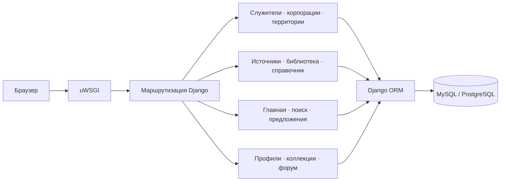

# Архитектура

Описание сверено с локальной веткой `design/archive-home`, коммит `190340c`,
17 ноября 2026 года. Основные нововведения — в
[обзоре изменений](design-archive-home.md). Наличие функции в ветке не означает,
что она уже развёрнута на публичном сайте.

Сайт построен на Django 5.2.17 по схеме «модель — представление — шаблон» (MVT).
Страницы формируются на сервере; интерфейс использует HTML, CSS, Bootstrap 5.3,
Font Awesome и собственный JavaScript. Карты работают на Leaflet 1.9.4,
поставляемом локально вместе с лицензией. JS-фреймворков нет.

## Приложения

| Приложение | Назначение |
|---|---|
| `main` | Главная, общие страницы, поиск, навигация, настройки разделов, лента изменений, предложения записей и обращения |
| `archive_servants` | Модели служителей (`Person`, `Education`, `Service`, `MilitaryService`, `Property`), формы, страницы и фотографии |
| `corporations` | Каталог дворянских корпораций, описания и фотогалереи |
| `territories` | Территории, связи с архивом, границы, метки и редактор исторических карт |
| `reference` | Словарь терминов, определения и ссылки на словари |
| `sources` | Архивы, их фонды, фотографии и ссылки |
| `library` | Библиографические записи и классификация литературы |
| `users` | Учётные записи, роли, профили, публикации, коллекции, заметки и интерфейс модерации |
| `forum` | Темы, сообщения, вложения, реакции и ограничения участия |
| `monitoring` | Посещения, просмотры и журнал действий |

Модели служителей перенесены из `main` в `archive_servants`; общая модерация
и лента изменений остаются в `main`.

## Главная и поиск

Главная содержит поиск, четыре последних посещённых раздела, новые и обновлённые
материалы, новости форума, блок помощи проекту и обратную связь.
История разделов хранится в браузере отдельно для гостя и аккаунтов;
при недоступности хранилища показывается исходный набор карточек.

Простой поиск охватывает шесть разделов архива. Он ищет без учёта регистра и различий «е/ё»,
повышает совпадения в названии и региональные списки, а при отсутствии прямых
совпадений пробует другую раскладку и близкие написания. Номера фондов автоматически
не исправляются. Реализация работает средствами SQL и Python без внешнего сервиса.

Расширенный поиск добавляет открытый форум, активные публичные профили и страницы
сайта. Доступны тип материала, губерния, годы рождения, статус образования,
автор и даты публикаций форума, точная фраза, сортировка и пагинация.
Поля и фильтр службы доступны редакторским ролям. Личные заметки, обращения,
email и неопубликованные предложения не становятся публичной выдачей.

Кандидаты отбираются в SQL, затем проверяются средствами Python. Для сортировки
и постраничной выдачи расширенного поиска используется временная база SQLite;
основная база сайта остаётся MySQL или PostgreSQL. Широкие запросы могут требовать
просмотра большого числа кандидатов; гарантии скорости без нагрузочных измерений нет.

## Маршруты

| Путь | Назначение |
|---|---|
| `/`, `/search/` | Главная с поиском; расширенный поиск |
| `/about/`, `/archive/`, `/feedback/` | О проекте, каталог разделов, обратная связь |
| `/list/`, `/region/<регион>/`, `/list/<id>/` | Служители, региональный список, биографическая карточка |
| `/noble_corporations/` | Каталог и карточки корпораций |
| `/territories/` | Каталог и карточки территорий |
| `/sources/`, `/library/`, `/reference/` | Архивы и фонды, библиография, справочник |
| `/forum/` | Новости и обсуждения |
| `/registration/`, `/login/`, `/login/code/`, `/profile/` | Регистрация, вход, почтовый код, личный кабинет |
| `/users/<username>/` | Публичный профиль |
| `/collections/shared/<token>/` | Подборка, открытая владельцем по ссылке |
| `/manage/moderation/`, `/manage/messages/` | Предложения материалов, обращения и заявки в редакторы |
| `/manage/users/`, `/manage/settings/` | Управление пользователями и настройками сайта |
| `/monitoring/`, `/admin/` | Мониторинг и административная панель Django |

## Роли и публикация

| Роль | Права при отсутствии ограничений участия |
|---|---|
| Гость | Читает открытые разделы и форум, пользуется публичным поиском, отправляет обратную связь и заявку в редакторы |
| Пользователь | Дополнительно предлагает записи и исправления, пишет на форуме, ведёт коллекции и приватные заметки |
| Редактор | Публикует новые записи напрямую; изменения и удаления отправляет на модерацию; видит закрытые для читателей поля служителей |
| Главный редактор | Публикует, изменяет и удаляет записи, рассматривает предложения и обращения, управляет обычными редакторами и настройками |
| Администратор | Дополнительно управляет главными редакторами, блокировками, email и удалением аккаунтов; имеет полномочия суперпользователя |

Редактор определяется группой «Редакторы»; главный редактор — группой
«Главные редакторы», флагом `is_staff` или статусом суперпользователя.
Произвольная группа больше не даёт редакторских полномочий.
Администратор — пользователь с `is_superuser`; этот флаг назначается только в `/admin/`.
Выдача редакторской роли требует подтверждённого email.

В карточках служителей редакторским ролям дополнительно доступны служба
в дворянских учреждениях, военная служба, возраст при вступлении на службу
и составлении формуляра, годовое жалование и тип образования. Биография,
семья, награды, имущество, примечания и источники доступны читателям открытого раздела.

Предложения до одобрения не меняют опубликованные записи. Модератор видит автора,
изменённые поля и связанные материалы, принимает или отклоняет предложение
с комментарием. Изменение исходной записи после отправки блокирует принятие
устаревшего предложения. Повторное принятие не публикует запись заново.
Файлы предложений остаются закрытыми до публикации.

Каждый из шести разделов можно временно отключить в настройках. Его карточка
остаётся с замком, а прямые адреса перенаправляют остальных посетителей в каталог.
Главные редакторы и администраторы сохраняют доступ. Закрытие требует подтверждения.

Ограничения участия запрещают публикации, предложения и редакторские действия;
чтение, профиль и обратная связь сохраняются. У ограниченного главного редактора
закрывается также «Управление». Роль при этом не снимается.

## Личная работа и карты

Служителей, корпорации, территории, архивы и библиографию можно сохранять
в коллекции и снабжать приватными заметками. Публикация подборки по ссылке
открывает материалы, но не заметки владельца и не закрытые разделы.
Профиль также поддерживает публикации и внешние ссылки.

Редактор территории позволяет загрузить исторический скан, совместить ориентиры,
нарисовать границу и добавить метки. Также поддерживаются подготовленные тайлы
исторических карт. Современная подложка использует OSM; при недоступности
интерактивной карты остаётся SVG-контур. Привязка обычного скана приблизительна,
исторические границы задаются исследователем явно.

В текстовых редакторах служителей, корпораций и территорий можно вставлять ссылки
на термины, служителей, корпорации и территории через общий поиск.
Просмотр фотографий использует общий просмотрщик сайта.

## Безопасность и эксплуатация

- Права проверяются на сервере; скрытие кнопок дополняет эти проверки.
- Выход и изменяющие действия защищены CSRF; удаление выполняется POST-запросом.
- Регистрация требует подтверждения email. После пароля редакторским ролям нужен
  одноразовый шестизначный почтовый код, включая вход в `/admin/`.
- Код действует 10 минут и гасится после пяти неверных попыток; повторная выдача
  ограничена. Подтверждения email одноразовые, новая ссылка отменяет предыдущую.
- Общие счётчики запросов в базе ограничивают попытки входа, регистрации,
  подтверждения адреса и отправки форм; превышение возвращает HTTP 429.
- Форум ограничивает флуд и повторяющиеся сообщения; пользовательский HTML не исполняется.
- Стандартные защиты Django включают хеширование паролей, защиту от clickjacking
  и `nosniff`. HTTPS-режим включает secure-cookie и HSTS.
- Конфигурация и секреты находятся в `infra/.env` вне репозитория.
- Статика собирается `collectstatic` с хешами файлов. Новые фотографии сжимаются
  в WebP; пользовательские файлы требуют отдельного резервного копирования.

## Проверки

Тесты Django находятся в `tests/` по приложениям. Они охватывают права и видимость
полей, модерацию и конфликты, поиск, миграции служителей и фондов, карты, коллекции,
форум, почтовый вход, подтверждение email и ограничения запросов.
Конкурентные проверки требуют СУБД с поддержкой `SELECT FOR UPDATE`.

Проверки JavaScript запускаются через `node --test`; отдельные браузерные проверки
редактора ссылок используют Playwright и Microsoft Edge с подменёнными ответами архива.
Прежнее число «33 автотеста» больше не описывает состав ветки.
