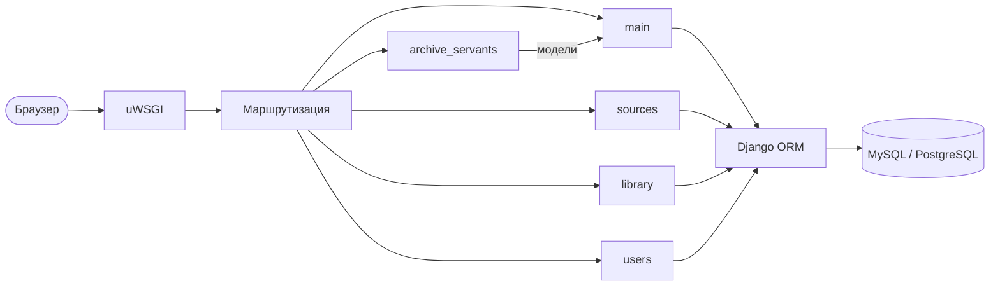
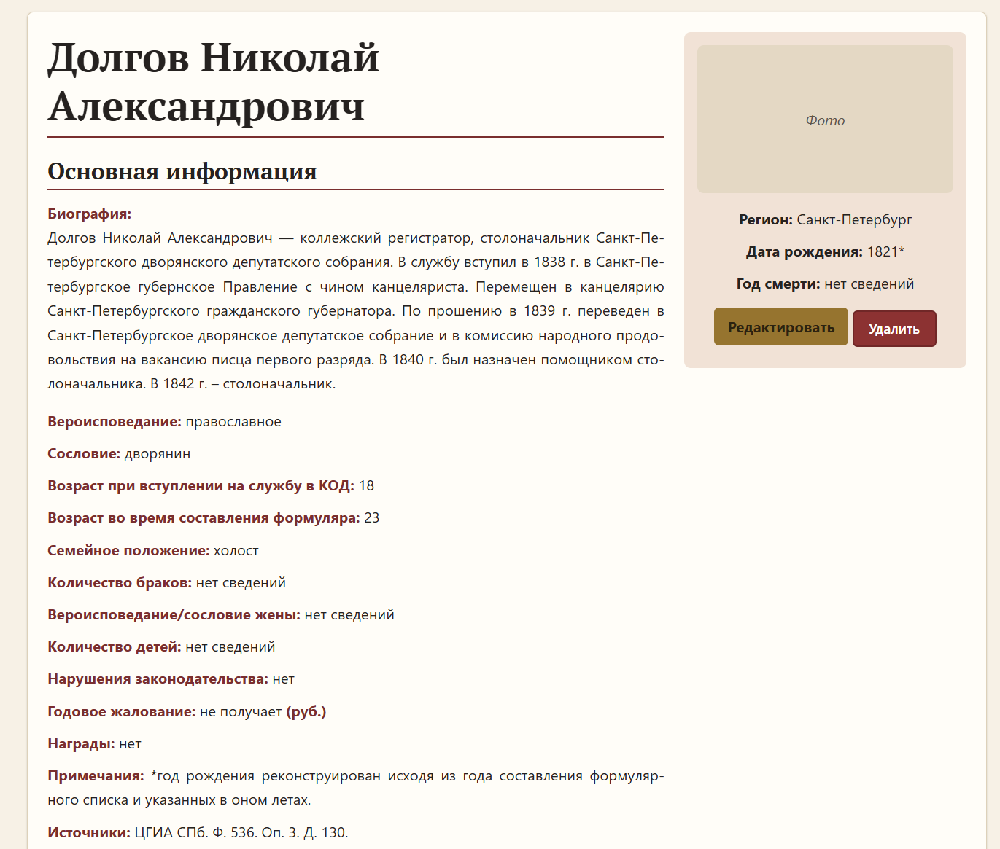

# Архитектура

Сайт построен на Django 5.2 по схеме «модель — представление — шаблон» (MVT).
Страницы формируются на сервере встроенным шаблонизатором Django; клиентская часть —
HTML и CSS с Bootstrap, без JS-фреймворков. Это снижает нагрузку на слабый виртуальный
хостинг и упрощает сопровождение.

## Приложения

Проект разбит на пять приложений, каждое отвечает за свою предметную область:

| Приложение | Назначение |
|---|---|
| `main` | Модели служителей (`Person` и связанные таблицы), общие страницы: главная, «О проекте», разделы веб-архива |
| `archive_servants` | Просмотр, поиск и редактирование биографических справок |
| `sources` | Просмотр и редактирование архивных источников (`Source`) |
| `library` | Просмотр и редактирование библиографии (`LibraryEntry`) |
| `users` | Регистрация, авторизация, профиль, роль редактора |

## Маршруты

| Путь | Страница |
|---|---|
| `/` | Главная, последние добавленные служители |
| `/about/` | О проекте и участниках |
| `/archive/` | Разделы веб-архива |
| `/noble_corporations/` | Дворянские корпорации (в разработке) |
| `/list/` | Служители, сгруппированные по регионам; поиск по ФИО (`?q=`) |
| `/region/<регион>/` | Полный список служителей региона |
| `/list/<id>/` | Персональная страница служителя |
| `/add_person/`, `/edit_person/<id>/`, `/person/<id>/delete/` | Добавление, правка, удаление (редактор) |
| `/sources/` | Источники (+ добавление и правка для редактора) |
| `/library/` | Библиотека (+ добавление и правка для редактора) |
| `/registration/`, `/login/`, `/logout/`, `/profile/` | Учётная запись |
| `/admin/` | Панель администратора Django |

## Роли и права доступа

Система различает три категории посетителей:

| Возможность | Аноним | Зарегистрированный пользователь | Редактор |
|---|:---:|:---:|:---:|
| Главная, «О проекте», источники, библиотека | ✅ | ✅ | ✅ |
| Список служителей, поиск, персональные страницы | ✅ | ✅ | ✅ |
| Биография, вероисповедание, сословие, семейное положение, награды, имущество, примечания, источники | ✅ | ✅ | ✅ |
| Служба в дворянских учреждениях, военная служба, возраст при вступлении на службу и при составлении формуляра, годовое жалование, тип образования | — | — | ✅ |
| Добавление, правка и удаление служителей, источников, записей библиотеки | — | — | ✅ |

Обычный зарегистрированный пользователь пока имеет те же права, что и аноним.
Редактором считается сотрудник (`is_staff`), суперпользователь или пользователь, которого
администратор добавил хотя бы в одну группу через панель Django.

## Безопасность

- **Проверка прав на сервере.** Все представления, изменяющие данные, обёрнуты в собственный
  декоратор: анонима он отправляет на страницу входа, авторизованного пользователя без прав
  редактора — на ошибку 403. Проверка в шаблонах лишь скрывает или показывает кнопки
  и не является защитой.
- **Удаление только POST-запросом** — по прямой ссылке ничего удалить нельзя.
- **Стандартные механизмы Django:** защита от CSRF, хеширование паролей, валидаторы сложности
  пароля, запрет встраивания в чужие страницы (`X-Frame-Options: DENY`, защита от clickjacking),
  `X-Content-Type-Options: nosniff`.
- **HTTPS-режим** включается одной переменной окружения: перенаправление на HTTPS,
  secure-cookie для сессии и CSRF, HSTS.
- **Секреты вне кода.** Секретный ключ, параметры БД, `DEBUG`, `ALLOWED_HOSTS` и доверенные
  источники CSRF задаются в `.env`, который не попадает в систему контроля версий.

## Обработка архивных данных

- Пустое значение в форме сохраняется как `NULL` и выводится на сайте как «нет сведений» —
  так отсутствие сведений не путается с нулём (например, «0 детей»).
- Числовые поля (возраст при вступлении на службу, число браков и детей) проверяются
  на неотрицательность.
- Даты хранятся текстом, поскольку архивные данные часто приблизительны
  («около 1800 г.», «1821*»). Подробнее — в [database.md](database.md).
- Для переноса данных с сервера в локальную среду есть отдельная management-команда загрузки дампа.

## Статические файлы

Статика собирается `collectstatic` с хешем в имени файла (`main.3f9a1c2b.css`), поэтому после
обновления стилей браузеры не показывают устаревший CSS из кэша. Если записи в манифесте нет
(например, при локальной разработке), отдаётся обычный адрес — сайт не теряет стили.

## Тестирование

33 автотеста на встроенном тестовом фреймворке Django. Основное внимание — чувствительным
местам системы:

| Приложение | Что проверяется |
|---|---|
| `users` | Правило определения редактора для анонима, обычного пользователя, участника группы, сотрудника и суперпользователя; соответствие правила в шаблонах и на сервере; вход, регистрация, профиль |
| `archive_servants` | Сортировка по ФИО и регионам («регион не указан» — в конце), поиск, полный список региона; видимость полей для разных ролей; доступ к добавлению, правке и удалению; сохранение пустых полей как `NULL`; отклонение отрицательных чисел; 404 для несуществующей записи |
| `sources`, `library` | Добавление, правка и удаление только для редактора; удаление только POST-запросом; кнопки видны только редактору |
| `main` | Открытие публичных страниц, тексты главной, год в подвале, favicon |
