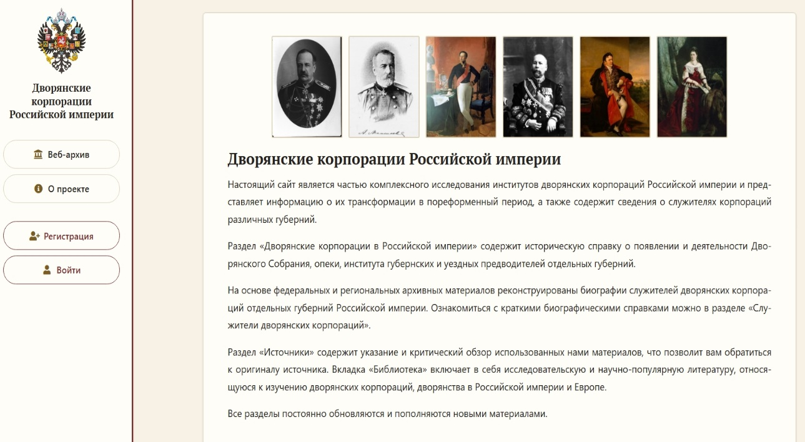
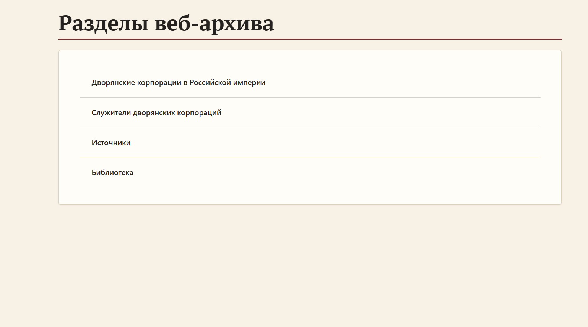
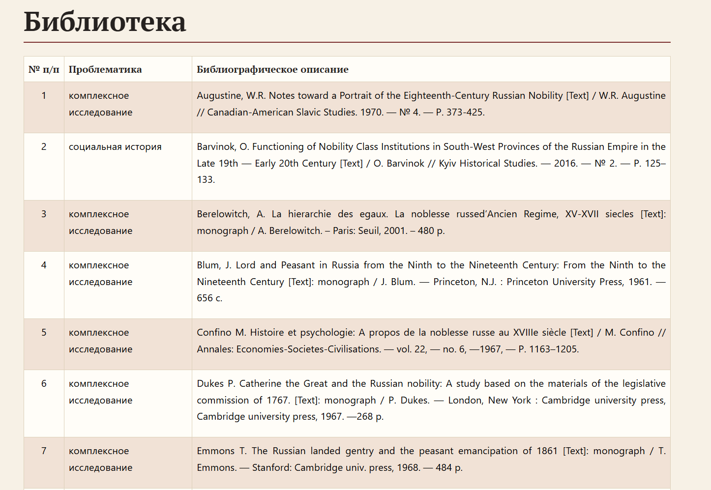
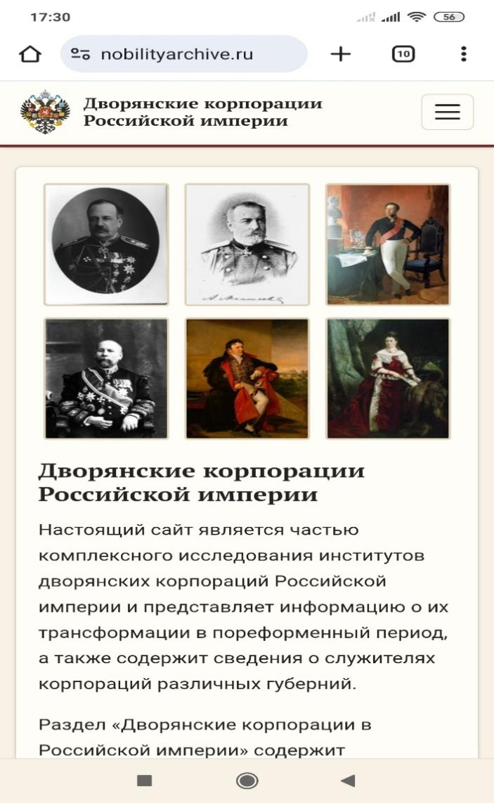
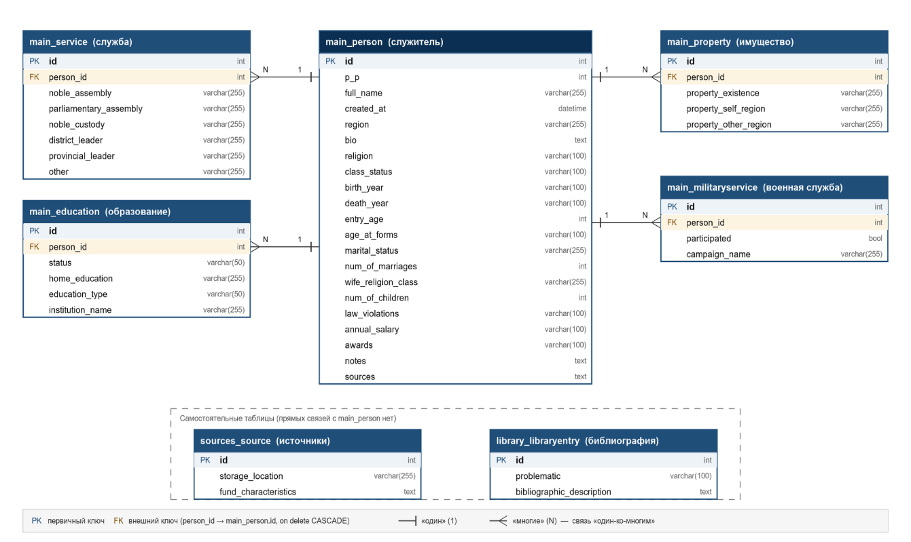

# Дворянские корпорации Российской империи: опыт создания исторического интернет-ресурса

**Авторы:** И. О. Трубицын, Е. П. Баринова, Д. В. Логинов

**Публикация:** [Историческая информатика](https://nbpublish.com/e_istinf/). 2026. № 4. С. 18–31.
DOI: [10.7256/2585-7797.2026.4.82471](https://doi.org/10.7256/2585-7797.2026.4.82471).
EDN: ZTOWGR.
Оригинал: [nbpublish.com/library_read_article.php?id=82471](https://nbpublish.com/library_read_article.php?id=82471).
Лицензия: [CC BY-NC 4.0](https://creativecommons.org/licenses/by-nc/4.0/).

> Текст статьи о проекте [nobilityarchive.ru](https://nobilityarchive.ru/), приведённый
> в соответствие с опубликованной версией. Описание актуального состояния проекта —
> в [документации](../../README.md#документация).

---

В последние десятилетия в интернет-пространстве появилось множество различных генеалогических информационно-поисковых ресурсов и баз данных, что кардинально расширило возможности генеалогического поиска. Как отмечает Л. И. Бородкин количество подобных ресурсов можно исчислить тысячами, а их прирост наблюдается ежедневно [1, с. 147]. В настоящее время одним из актуальных направлений является создание специализированных веб-архивов. Они позволяют исследователям использовать удобные инструменты для работы с источниками, а также осуществлять поиск генеалогических и исторических данных в интернет-пространстве. Рост интереса к семейной истории, истории повседневности, а также к биографическим и генеалогическим исследованиям породил два вида интернет-ресурсов, отвечающих этим целям: созданных представителями профессионального научного сообщества [2; 3] и энтузиастами-любителями [4].

Созданные энтузиастами информационно-поисковые ресурсы, как правило, включают представителей самых разных сословий дореволюционной России и представляют собой базу данных, а также возможность обмена информацией между посетителями сайта посредством форума. Среди наиболее удачных проектов можно назвать Российский родословный фонд [5], и Всероссийское генеалогическое древо [6]. Создатели таких сайтов преследуют цель не только сплотить единомышленников, объединенных одной тематикой, но в том числе, и коммерческие цели, а сайт скорее всего является рекламой их возможностей [7]. Представители научного сообщества создают сайты в рамках исследовательских проектов, как правило, при грантовой поддержке и представляют итоги своего исследования [8, 9].

Главной проблемой, с которой сталкивается исследователь, осуществляющий поиск информации на генеалогических сайтах, является отрывочность и противоречивость данных, представленных на них. Наиболее распространёнными ошибками является отождествление биографических данных разных людей, причем не только полных тезок, но и однофамильцев, неточное указание дат рождения, смерти, заключения брака. Зачастую отсутствуют сведения о матримониальном статусе, наличии и количестве детей, их датах рождения или смерти. Подобная фрагментарность данных обусловлена несколькими причинами: недостаточной сохранностью архивных фондов, особенностями демографического учета населения в Российской империи, а затем РСФСР и СССР, спецификой фиксации, ошибками при внесении записей в книги метрического и актового учета. Кроме того, в условиях социальных пертурбаций, войн и революций первой трети XX века, когда разрушались семейные связи, было уничтожено много документов, а часть биографических данных скорректирована, тщательно заретуширована или изменена членами семьи, либо самой личностью. Поэтому один ресурс, даже самый обширный, не позволяет заполнить контекстуальные лакуны в биографии того или иного человека. Необходима тщательная проверка и верификация данных. Однако, к сожалению, для большинства информационных генеалогических ресурсов характерно отсутствие указаний на используемые источники, что снижает уровень доверия к приведенным данным.

Ресурсы, затрагивающие интересующую нас дворянскую тематику созданы как профессиональными исследователями, так и любителями-генеалогами или краеведами [7; 11;12]. Интернет-ресурсы, посвященные истории дворянских корпораций в Российской империи и содержащие биографические материалы о их служителях, в настоящее время отсутствуют, что обуславливает новизну нашего проекта.

Данная статья описывает часть проекта, посвященного изучению дворянских корпораций в России реализуемого ее авторами. Работа в этом направлении потребовала от разработчиков создания ресурса для упорядоченного хранения и достаточно простого в использовании широким кругом лиц массива текстовых данных. Созданный нами проект с доменным именем «nobilityarchive.ru» направлен на публикацию и систематизацию информации о дворянских корпорациях Российской империи и их представителях. Основу содержательной части составляют биографические сведения о членах дворянских корпораций, обзор источников, использованных в ходе реализации проекта, а также перечень литературы, которая может быть использована пользователями при изучении истории дворянского сословия и его корпоративных институтов. Реализация проекта включает в себя два этапа. На первом этапе авторы сконцентрировали свои усилия на создании и заполнении реляционной базы данных относительно корпуса служителей дворянских объединений в регионах Российской империи. На втором этапе была разработана структура и дизайн сайта, а также запущена его пилотная версия, которая описана в данной статье.

Целью проекта является публикация в открытом доступе результатов нашей работы по изучению дворянских корпораций в России, привлечение внимания исследователей к использованию и пополнению веб-архива. В данной статье мы продемонстрируем как сайт проекта может быть представлен неавторизованному пользователю (далее аноним), авторизованному пользователю и пользователю с правами редактора, а также опишем информационную систему, на базе которых он был подготовлен.

### Позиция пользователей: сайт https://nobilityarchive.ru/ (Дворянские корпорации Российской империи).

Главная страница проекта «Дворянские корпорации Российской империи» (рис.1) знакомит пользователя с информацией, содержащейся в основных разделах веб-архива (о них далее). В нижней части пользователь может увидеть новые записи, внесенные в раздел веб-архива «Служители дворянских корпораций». В левой части страницы расположена навигация сайта и возможность авторизации и регистрации новых участников проекта. Навигация по сайту предполагает переход к разделам веб-архива и к информации о реализуемом проекте и его участниках. Она доступна на всех страницах сайта.

*Рисунок 1 — Фрагмент главной страницы (снимок экрана автора статьи)*

Структура нашего веб-архива представлена четырьмя разделами (рис.2). Три из которых для неавторизованного пользователя, за исключением раздела «Служитель дворянских корпораций» являются полностью доступными.

*Рисунок 2 — Разделы веб-архива (снимок экрана автора статьи)*

Раздел «Дворянские корпорации в Российской империи» (в настоящее время находится в разработке) будет содержать историческую справку о возникновении и деятельности институтов дворянских корпораций в различных регионах страны.

Наибольшего внимания заслуживает раздел «Служители дворянских корпораций», который содержит биографические сведения о служителях различных сословий в дворянских корпорациях. В настоящее время на сайте размещено 777 биографических справок о служителях: Самарской, Санкт-Петербургской, Саратовской, Ставропольской, и Владимирской губерний. Источниковую базу данного раздела составили, прежде всего, формулярные списки о службе, выявленные нами в региональных архивах, адрес-календари и памятные книжки губерний, материалы периодической печати, а также исследования историков и краеведов содержащие аннотированные списки дворян и биографические сюжеты [14-18]. Сайт поддерживает сортировку служителей по регионам и поиск по имени. Неавторизованный пользователь сможет просматривать страницы персоналий, созданные в wiki-стиле. Также в этом разделе ему будет доступна следующая информация: биографическая справка служителя, его вероисповедание, сословие, наличие наград, образование, семейное и имущественное положение, а также ссылка на источники и примечания. Остальные же разделы базы данных, детализирующие те или иные аспекты биографии служителя, например — возраст вступления на службу в дворянскую корпорацию, количество детей, будут доступны только авторизованному пользователю с правами редактора. Данные сведения могут быть использованы при проведении просопографических исследований.

На данный момент авторизированные пользователи могут иметь две роли. В роли редактора доступны все поля лежащей в основе раздела базы данных. В связи с этим пользователь в такой роли может видеть, вносить изменения на персональных страницах служителей или удалять их (рис.3). Обычный же пользователь имеет права, равнозначные анониму. На персональных страницах служителей, в верхнем правом углу, размещен плейсхолдер изображения, который в перспективе разработки сайта будет заменен реальными фотографиями служителей дворянских корпораций.

*Рисунок 3 — Фрагмент страницы авторизованного пользователя в роли редактора (снимок экрана автора статьи)*

Раздел «Источники» содержит информацию с указанием использованных нами входе работы над проектом архивных фондов, которые представлены пользователю, как авторизованному, так и нет, в виде таблицы, состоящей из трех столбцов: порядковый номер, место хранения и характеристика фондов. Ценным с исследовательской точки зрения может быть приведенная информация о наличии формулярных списков о службе служителей дворянских обществ и их степень сохранности за разные периоды их деятельности в Российской империи. Проблемы поиска и верификации были описаны подробно нами ранее [13].

Раздел «Библиотека» включает в себя литературу и информационно-поисковые ресурсы охватывающую дворянскую тематику в целом. Стоит сразу отметить, что авторы не претендуют на исчерпанность и всесторонность приведенных ресурсов в данном разделе веб-архива. В задачи авторов входило, прежде всего, представить в общих чертах историографическую традицию и сориентировать неискушенного пользователя нашего сайта. Структура раздела представлена таблицей из трех полей: порядковый номер, проблематика и библиографическое описание (рис. 4). Вносить изменения, дополнять раздел «Библиотека», как и раздел «Источники» могут пользователи с правами редактора.  В раздел «Библиотека» вошли диссертации, монографии, научные статьи, отражающие как традиционные для исторической науки области изучения дворянства за последние два столетия (социально-экономические, правовые аспекты, историографические и источниковедческие сюжеты), так и исследования, проведенные в области исторической информатики, истории повседневности. Проблематика приведенных библиографических описаний ресурсов включает в себя девятнадцать аспектов отражающих, в том числе краеведческую литературу, справочные издания и информационно-поисковые ресурсы. Последние представлены разработками профессиональных историков и энтузиастов. Значительная часть исследований, приведенных в данном разделе, сочетает в себе разную проблематику в связи с чем такие работы обозначены в разделе «Проблематика» как комплексное исследование.

*Рисунок 4 — Фрагмент раздела «Библиотека» (снимок экрана автора статьи)*

Для сайта также была реализована мобильная версия, точно повторяющая существующий функционал и разделы веб-сайта с оптимизацией под экраны мобильных устройств (рис 5).

*Рисунок 5 — Фрагмент главной страницы сайта мобильной версии (снимок экрана автора статьи)*

В качестве основной технологической платформы нами был использован фреймворк Django версии 5.2 на Python 3. Проект разработан по схеме «модель — представление — шаблон» и разбит на пять приложений, каждое из которых самобытно, отвечает за свою предметную область и легко масштабируется. Они представлены следующим образом: «main» — модели служителей и общие страницы; «archive_servants» — просмотр, поиск и редактирование биографических справок; «sources» — просмотр и редактирование архивных источников; «library» — просмотр и редактирование библиографических данных и «users» — модель пользователей, регистрация, авторизация и роли.

Модель в данной системе является описанием табличной структуры базы данных. Для ее создания используется Django ORM (Object Related Mapping), позволяет формировать привычные запросы в структурированной форме. В его основе лежат идеи объектно-ориентированного программирования, где данные представляются в виде объектов, с которыми можно взаимодействовать. Именно эта особенность не привязывает разработку к конкретной СУБД. Для локальной реализации и первых тестов использовалась PostgreSQL, однако при переходе на сервер окончательный выбор встал на сторону MySQL в связи с ограничениями хостинга. В конфигурации проекта «settings.py» подготовлена реализация выбора СУБД в зависимости от требования разработчика.

Страницы формируются встроенным шаблонизатором Django (DTL) с использованием HTML и CSS, клиентская часть не требует JS фреймворков, что снижает нагрузку на сервер и упрощает сопровождение. Описанная структура послужила основанием для выбора Django в качестве фреймворка при реализации нашего проекта.

Всего созданная нами база данных состоит из семнадцати таблиц (рис. 6). Все кроме описанных выше являются служебными и созданы фреймворком автоматически для хранения критически важной для Django инфраструктуры.

*Рисунок. 6 — Схема отношений реляционной базы данных (снимок экрана автора статьи). Актуальная схема всех таблиц — в [документации по базе данных](../database.md).*

Предметная часть БД включает в себя семь таблиц, ключевым звеном которых являются служители. Центральная таблица «Person» содержит основные сведения о личности формулярного списка: ФИО, регион, даты жизни, вероисповедания, сословие, семейное положение, число браков и детей, годовое жалование, награды, примечания и ссылки на источники. Четыре подчиненные таблицы: «Service», «Property», «MilitrayService», «Education» связаны с «Person» внешним ключом по принципу «один–ко–многим». Подробное соответствие разделов биографии служителя таблицам представлены в таблице (см. Табл. 1). В свою очередь таблицы «Source» и «LibraryEntry» самостоятельны и обслуживают разделы «Источники» и «Библиотека».

| Раздел биографии | Таблица | Ключевые поля |
|---|---|---|
| Имя, происхождение, общая информация | Person | ФИО, регион, биография |
| Возраст, семейное положение | Person | Возраст, количество браков, число детей |
| Образование | Education | Тип, статус, учреждение |
| Служба в дворянских учреждениях | Service | Служба в дворянском собрании, служба уездным правителем |
| Участие в военных кампаниях | MilitaryService | Факт участия, название компании |
| Имущество | Property | Факт наличия, в регионе проживания, в других регионах |
| Награды, взыскания | Person | Награды, нарушения законодательства |

*Таблица 1 — Описание полей БД*

Ниже на рисунке представлена ER-диаграмма, на которой можно увидеть связи между созданными таблицами (рис. 7). Отметим, что поля с датами осознанно обозначены текстовым полем «varchar», так как архивные данные часто предполагают приближенную информацию, например: около 1800 года рождения.

*Рисунок. 7 — ER-диаграмма (снимок экрана автора статьи)*

Рассмотрим вопрос безопасности веб-сайта. На данный момент система различает три категории посетителей: аноним, авторизированный пользователь и пользователь с правами редактора. Уровни доступов пользователей были описаны выше. Роль редактора назначается администратором через панель управления Django.

Проверка прав выполняется на стороне сервера. Любые представления, изменяющие данные, обернуты в собственный декоратор, который отправляет анонима на страницу входа, а обычного пользователя без прав редактора отклоняет с ошибкой 403. Стоит отметить, что проверка прав происходит и на самой веб-странице, однако служит лишь декоративным элементом — скрывает или показывает кнопки удаления и редактирования.

В проекте использованы и стандартные механизмы Django: защита от подделки межсайтовых запросов (CSRF), хэширование паролей, валидаторы сложности пароля и защита от встраивания в чужие страницы (clickjacking).

Все конфиденциальные данные (секреты) задаются переменной окружения (.env). Конфигурация этой переменной происходит при первой инициализации сервиса на сервере. Работоспособность всех чувствительных элементов кода, таких как проверки ролей, покрыты автоматическими тестами, которых суммарно для всей системы насчитывается более 30.

Код проекта хранится в системе контроля версий Git, в личном, приватном репозитории на сервисе GitHub (https://github.com/), синхронизированный с хостингом через публичный ключ, позволяющий немедленную доставку программного кода на сервер. Выпуск новой версии выполняется единым сценарием, реализованным в shell-скрипте «deploy.sh», который проверяет чистоту рабочей копии и требует подтверждения существования актуальной резервной копии базы. Помимо этого, происходит обновление зависимостей, проверка настроек, применение плана миграций и сбор статистики. Порядок выпуска и отката описан в отдельной инструкции в репозитории проекта.

Разработка сайта велась в кроссплатформенной интегрированной среде разработки для языка Python-IDE PyCharm, которая предоставляет инструменты для написания кода и работы с базой данных. Сайт размещён на хостинге «Спринтхост», предлагающем 1 ГБ дискового пространства, 1 вычислительное ядро и 512 МБ ОЗУ. Хостинг обеспечивает базовый уровень безопасности и стабильности работы ресурса.

Таким образом, реализуемый нами проект по созданию нового интернет-ресурса, связанного с изучением истории дворянского сословия, позволяет широкому кругу пользователей ознакомится со сведениями биографического характера, литературой и источниками. Модульная архитектура на базе Django, использование MySQL и минималистичный интерфейс обеспечивают удобство работы и перспективы развития. Созданный сайт не является завершенной версией проекта, работа над его совершенствованием продолжается. Кроме дальнейшего пополнения сайта биографическими и библиографическими материалами авторы планируют реализацию размещения фотоматериалов на персональных страницах служителей дворянских корпораций, а также внедрение возможности продвинутой система фильтрации и умного поиска.

## Литература

1. Бородкин, Л. И. Историко-ориентированные тематические сайты: источниковедческие аспекты разработки контента / Л. И. Бородкин // Информационный бюллетень Ассоциации «История и компьютер». — 2006. — № 34. — С. 147–150. — EDN: NOYGUA.
2. Волков, С. В. Сайт историка С. В. Волкова : [сайт]. — URL: https://swolkov.org/ (дата обращения: 26.08.2026). — Текст : электронный.
3. Динамика экономического и социального развития России в XIX – начале XX вв. : проект : [сайт]. — Москва, [2000] – . — Обновляется в течение года. — URL: http://www.hist.msu.ru/Labs/Ecohist/version/r_databa.htm (дата обращения: 26.08.2026). — Текст : электронный.
4. Soroka 1736 : генеалогия и краеведение : проект : [сайт]. — Обновляется в течение года. — URL: Soroka1736.ru (дата обращения: 26.08.2026). — Текст : электронный.
5. Российский родословный фонд : проект : [сайт]. — Обновляется в течение года. — URL: https://rgfond.ru/ (дата обращения: 26.08.2026). — Текст : электронный.
6. Всероссийское генеалогическое древо : проект : [сайт]. — Обновляется в течение суток. — URL: https://vgd.ru/ (дата обращения: 26.08.2026). — Текст : электронный.
7. Дом предков : проект : [сайт]. — Обновляется в течение года. — URL: https://sluzhilye.ru/ (дата обращения: 26.08.2026). — Текст : электронный.
8. Карагодин А. В. Историко-ориентированный тематический сайт «Симеиз. Путеводитель по старым дачам»: этапы разработки и перспективы исследования // Историческая информатика. — 2020. — № 1. — С. 143–157. — DOI: [10.7256/2585-7797.2020.1.32009](https://doi.org/10.7256/2585-7797.2020.1.32009). — URL: https://nbpublish.com/library_read_article.php?id=32009
9. Стрекалова, Н. В. Базы данных по проблемам изучения социальной стратификации и мобильности городской элиты и средних слоев Тамбова в конце XIX – начале XX в.: источники, структура, технология комплексного анализа / Н. В. Стрекалова // Историческая информатика. — 2021. — № 4. — С. 50–66. — DOI: [10.7256/2585-7797.2021.4.36987](https://doi.org/10.7256/2585-7797.2021.4.36987). — EDN: MLLOPX.
10. Русский некрополь : проект : [сайт]. — Обновляется в течение года. — URL: https://rn-belgrade.ru/party/ (дата обращения: 26.08.2026). — Текст : электронный.
11. Культура и быт русского дворянства в провинции XVIII в. : проект «Дворяне-Вики» : [сайт]. — URL: Проект Дворяне-Вики (дата обращения: 26.08.2026). — Текст : электронный.
12. Захаров, А. В. Информационно-поисковая полнотекстовая система «Боярские списки XVIII века» / А. В. Захаров : проект : [сайт]. — Обновляется в течение года. — URL: https://zaharov.csu.ru/bspisok.pl-action=main_menu (дата обращения: 26.08.2026). — Текст : электронный.
13. Баринова, Е. П., Трубицын, И. О. Формулярные списки служителей дворянских корпораций: проблемы поиска и верификации / Е. П. Баринова, И. О. Трубицын // Via in Tempore. История. Политология. — 2024. — Т. 51, № 3. — С. 661–672. — DOI: [10.52575/2687-0967-2024-51-3-661-672](https://doi.org/10.52575/2687-0967-2024-51-3-661-672). — EDN: KRPJCP.
14. Алексушина, Т. Ф. Полный биографический словарь дворян Самарской губернии [Текст] / Т. Ф. Алексушина. — Самара : Типография «Прайм», 2015. — 504 с. — ISBN 5-98868-028-0. — Текст : непосредственный.
15. Алексушина, Т. Ф. Самарские страницы российского дворянства [Текст] / Т. Ф. Алексушина. — Самара : Типография «Эдельвейс», 2013. — 536 с. — ISBN 5-98868-019-7. — Текст : непосредственный.
16. Волков, С. В. Высшее чиновничество Российской империи : краткий словарь [Текст] / С. В. Волков. — Москва : Университет Дмитрия Пожарского, 2016. — 798 с. — ISBN 978-5-91244-166-0. — Текст : непосредственный. — EDN: YVMSUZ.
17. Беликов, Г. А. Замечательные люди Ставрополя [Текст] / Г. А. Беликов. — Пятигорск : Снег, 2019. — Кн. 1. — 287 с. : ил., портр. — ISBN 978-5-6041711-2-7. — Текст : непосредственный.
18. Невзорова, И. М. От Рустеберга до Елшанки: Очерки о России и Кноррингах / И. М. Невзорова. — Москва : [б. и.], 2024. — 574 с. — Текст : непосредственный.

Англоязычный список References приведён в [оригинальной публикации](https://nbpublish.com/library_read_article.php?id=82471).
