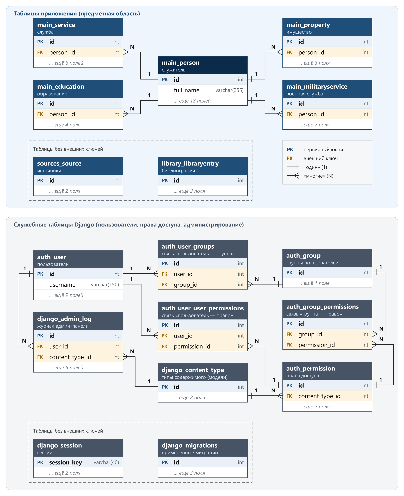
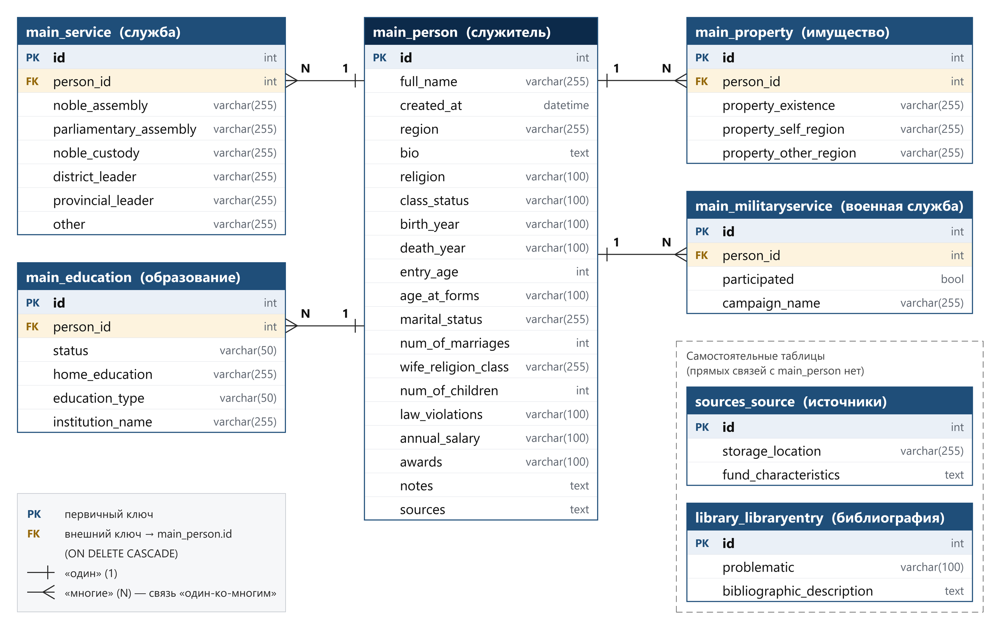
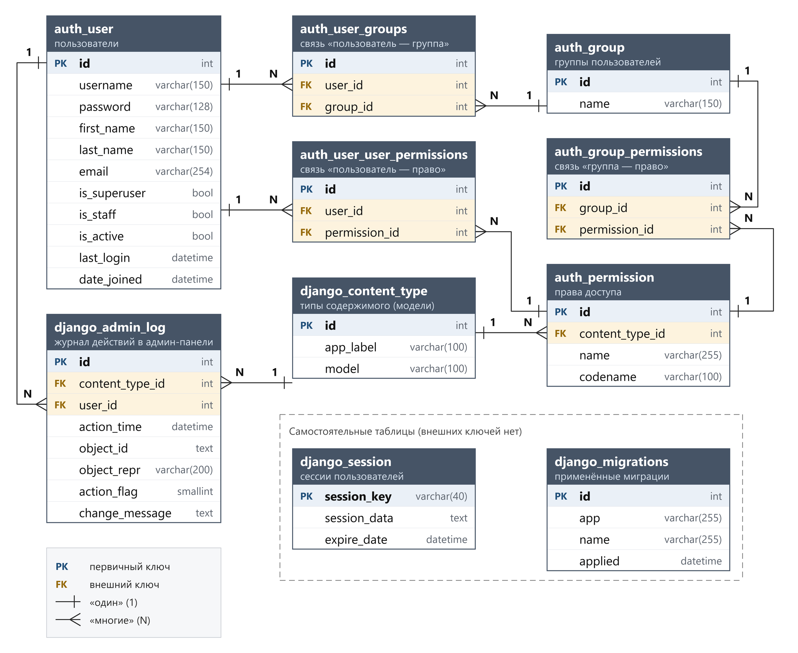

# База данных

Структура базы описана моделями Django ORM, поэтому проект не привязан к конкретной СУБД:
при локальной разработке и первых тестах использовалась PostgreSQL, на хостинге — MySQL
(выбор продиктован ограничениями хостинга). Нужная СУБД выбирается переменными окружения.

Всего в базе 17 таблиц: 7 предметных и 10 служебных, которые Django создаёт автоматически
(пользователи, группы, права, сессии, журнал админ-панели, применённые миграции).

## Предметная модель

Ключевое звено — служитель (`Person`). Его сведения заполняются по формулярному списку о службе.
Четыре подчинённые таблицы связаны с ним внешним ключом по принципу «один-ко-многим»
(при удалении служителя удаляются и связанные записи). Таблицы `Source` и `LibraryEntry`
самостоятельны и обслуживают разделы «Источники» и «Библиотека».

| Раздел биографии | Таблица | Ключевые поля |
|---|---|---|
| Имя, происхождение, общая информация | `Person` | ФИО, регион, биография, вероисповедание, сословие, годы жизни |
| Возраст, семейное положение | `Person` | Возраст при вступлении на службу и при составлении формуляра, семейное положение, число браков, вероисповедание и сословие жены, число детей |
| Образование | `Education` | Тип, статус, домашнее образование, учебное заведение |
| Служба в дворянских учреждениях | `Service` | Дворянское собрание, депутатское собрание, дворянская опека, уездный и губернский предводитель, другие учреждения |
| Участие в военных кампаниях | `MilitaryService` | Факт участия, название кампании или ополчения |
| Имущество | `Property` | Наличие, в своём регионе, в других регионах |
| Жалование, награды, взыскания | `Person` | Годовое жалование, награды, нарушения законодательства |
| Справочный аппарат | `Person` | Примечания, ссылки на источники |

### Справочники

**Тип образования:** среднее, высшее, военное, духовное учебное заведение; нет сведений.
**Статус образования:** закончено, не закончено, сдан экзамен; нет сведений.

### `Source` — архивные источники

Место хранения и характеристика фондов, включая сведения о наличии формулярных списков
и их сохранности за разные периоды.

### `LibraryEntry` — библиография

Проблематика (одно из 19 направлений, включая «комплексное исследование», краеведческую
литературу, справочные издания и информационно-поисковые ресурсы) и библиографическое описание.

## Решения, продиктованные архивными данными

- **Даты — текстом, а не типом `date`.** Архивные сведения часто приблизительны:
  «около 1800 г.», год рождения, реконструированный по году составления формуляра
  и указанному в нём возрасту (`1821*`). Строгий тип даты такие значения не выразит.
- **Жалование — текстом.** Встречаются значения вроде «не получает» или суммы с оговорками.
- **«Нет сведений» ≠ ноль.** Отсутствующее значение хранится как `NULL`, а не `0`
  или строка-заглушка. Это важно для подсчётов в просопографических исследованиях:
  «детей нет» и «о детях неизвестно» — разные факты.
- **Единый регистр значений.** Категориальные значения (семейное положение и др.)
  приведены к нижнему регистру, чтобы их можно было корректно группировать.
- **Отдельные таблицы для повторяющихся сведений.** Служитель мог служить в нескольких
  учреждениях, получать несколько видов образования, участвовать в нескольких кампаниях —
  поэтому эти сведения вынесены из `Person` в связанные таблицы.

## Служебные таблицы Django

Роль редактора опирается на стандартные таблицы `auth_user`, `auth_group` и `auth_user_groups`:
администратор назначает её через панель Django. Подробнее — в [architecture.md](architecture.md#роли-и-права-доступа).
