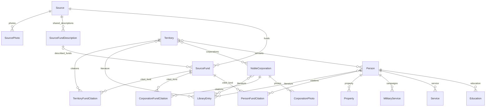

# База данных

Описание соответствует релизу **2.0.1** от 19 ноября 2026 года:
тег `v2.0.1`, ветка `main`, коммит `214f7d2`.
Модели описаны через Django ORM; основная СУБД — MySQL на хостинге
и PostgreSQL в локальной разработке. Выбор задаётся переменными окружения.

Прежняя схема из 17 таблиц устарела: добавлены предметные модели, модерация,
форум, коллекции, мониторинг и таблицы связей многие-ко-многим.
Ниже показаны основные отношения, без служебных таблиц Django и полного набора полей.

## Предметная модель

### Служители

`Person` и дочерние модели теперь принадлежат приложению `archive_servants`.
При переносе таблицы `main_person`, `main_education`, `main_service`,
`main_militaryservice`, `main_property` и таблица связей с библиотекой
переименовываются с префиксом `archive_servants_`. Идентификаторы и связи сохраняются;
это перенос существующих таблиц, а не повторный импорт биографий.

| Модель | Содержание |
|---|---|
| `Person` | ФИО, регион, биография, происхождение, годы жизни, семья, жалование, награды, примечания, текст источников и фотография |
| `Education` | Тип и статус образования, учебное заведение, домашнее образование |
| `Service` | Служба в дворянских учреждениях |
| `MilitaryService` | Военные кампании и ополчения |
| `Property` | Наличие имущества в своём и других регионах |

Повторяющиеся сведения связаны со служителем внешними ключами и удаляются
при удалении его карточки. Фонды и литература связываются многие-ко-многим.
У служителей, корпораций и территорий сохраняются автор создания, автор последней
правки, их имена и время обновления; удаление аккаунта не удаляет карточки.

### Источники и библиотека

`Source` описывает архив: место хранения и сайт. `SourcePhoto` хранит фотографии.
Фонды вынесены в дочернюю модель `SourceFund`: номер, название, описание со ссылками
и отдельное поле отображения в источниках. При пустом поле отображения используется
название фонда. К служителю можно привязать конкретный фонд.

В 2.0.1 добавлена `SourceFundDescription` — общее описание нескольких фондов
одного архива. Фонд может ссылаться на одно такое описание через необязательный
внешний ключ. При удалении общего описания фонды сохраняются (`SET_NULL`).
Группировка в интерфейсе не объединяет идентификаторы фондов: каждый остаётся
отдельной целью поиска и цитирования. Общий текст также участвует в поиске.

Связи с фондами используют промежуточные модели `PersonFundCitation`,
`CorporationFundCitation` и `TerritoryFundCitation`. В них хранится поле `detail`
для описи, дела и листов — отдельно для каждой пары «карточка — фонд».
Общий абстрактный класс `FundCitation` не создаёт самостоятельной таблицы.
Миграции используют существующие таблицы связей, сохраняют привязки и добавляют
новое текстовое поле; уникальность пары карточки и фонда сохраняется.

Миграция `sources.0004` переносит прежнюю общую характеристику архива в фонды.
Явные заголовки фондов разделяются, неоднозначный текст сохраняется с пометкой
о необходимости уточнения. Затем старое поле удаляется. Такие записи требуют
содержательной проверки; произвольные абзацы не считаются достоверными границами фондов.

`LibraryEntry` содержит библиографическое описание и проблематику из 19 направлений.
Записи библиотеки используются как источники служителей и территорий.

### Корпорации, территории и справочник

`NobleCorporation` хранит название, описание, связи с фондами и литературой,
а также выбор главной фотографии; `CorporationPhoto` — фотогалерею.
`Territory` хранит название, уездный город, губернию, историю, год карты,
изображение и ссылку на источник карты. Связи со служителями, корпорациями
и источниками (фондами и литературой) задаются явно. Текст региона у служителя не создаёт связь автоматически.
Удаление территории сохраняет связанные записи архива.

Граница, метки и точки привязки исторического скана хранятся в JSON-полях.
Для подготовленных исторических тайлов сохраняются адрес, схема XYZ/TMS,
масштабы, географический охват и авторство. Файлы сканов и изображений лежат в media;
в базе сохраняются пути и метаданные.

`ReferenceTerm` — термин, текстовое определение и необязательная HTTP(S)-ссылка на словарь.
Ссылки на термины и записи других разделов вставляются в поддерживаемые текстовые поля.

Связи корпораций с `SourceFund` и `LibraryEntry`, связь территорий с `SourceFund`
и выбор главного фото корпорации добавлены коммитом `190340c`.
Им соответствуют миграции `corporations.0003` и `territories.0011`.
Детализация архивного шифра добавлена миграциями `archive_servants.0005`,
`corporations.0004` и `territories.0012`, общие описания — `sources.0006`.

## Совместная и личная работа

| Модель | Назначение |
|---|---|
| `ArchiveChange` | Последнее изменение записи для ленты архива; уникальность по разделу и ID |
| `ArchiveProposal` | Операция создания/правки/удаления, автор, исходное состояние, предложенные данные, различия и решение модератора |
| `ProposalUpload` | Закрытые файлы предложения в базе до публикации |
| `EditorApplication` | Заявки в редакторы и обращения, обработка и решения |
| `SiteSettings` | Единственная запись настроек оформления и отключённых разделов |
| `Profile`, `Publication` | Профиль пользователя, внешние ссылки и его публикации |
| `PersonalPage` | Сохранение конкретного материала пользователем и приватная заметка |
| `Collection` | Именованная коллекция пользователя, материалы и необязательный UUID для доступа по ссылке |
| `Topic`, `Message`, `MessageAttachment`, `MessageLike`, `ForumAccess` | Темы, сообщения, файлы, реакции и ограничения участия |
| `Visit`, `PageView`, `Activity` | Посещения, просмотры и журнал действий |
| `LoginCode`, `VerificationRequest`, `SecurityLock`, `RequestLimit` | Почтовые коды, подтверждения адреса, синхронизация и ограничения запросов |

`PersonalPage` ссылается ровно на один материал: служителя, корпорацию, архив,
библиографическую запись или территорию. Ограничения базы исключают несколько
целей в одной записи и дубли пары «пользователь — материал».
Заметка остаётся приватной при публикации коллекции.

Лента `ArchiveChange` хранит последнее состояние изменения каждой записи;
она не заменяет журнал действий `Activity` и историю решений по предложениям.

Первичный ключ `SiteSettings` задаётся явно, запись настроек имеет ID 1.
Миграция `main.0024` убирает оставшийся автоинкремент в старых базах для
совместимости с MySQL. Восстановление пароля использует стандартный механизм
токенов Django и не добавляет отдельной таблицы.

## Работа с неполными сведениями

- Годы жизни и другие неточные даты хранятся текстом: возможны «около 1800 г.» и «1821*».
- Жалование также текстовое: встречаются суммы с оговорками и «не получает».
- Отсутствующие биографические сведения сохраняются как `NULL` там, где это
  предусмотрено моделью. Нулевое число детей и отсутствие сведений различаются.
- Возраст при вступлении на службу, число браков и детей проверяются
  на неотрицательность; повторяющиеся сведения вынесены в дочерние таблицы.
- Ограничения, валидаторы и явные связи дополняют редакторскую проверку источников.

## Служебные данные и миграции

Пользователи, группы, права, сессии и журнал административной панели опираются
на стандартные таблицы Django. Группы «Редакторы» и «Главные редакторы»
имеют разные полномочия; произвольная группа не заменяет назначение роли.

При переносе служителей сохраняются идентификаторы типов содержимого и права.
Переименование таблиц на MySQL требует отдельной репетиции на копии рабочей базы:
проверка на PostgreSQL не подтверждает поведение MySQL.
Порядок резервного копирования и выпуска — в [deployment.md](deployment.md).
