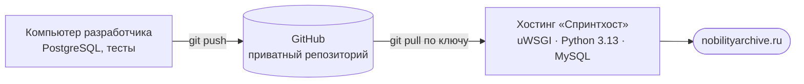

# Развёртывание

## Инфраструктура

| Параметр | Значение |
|---|---|
| Хостинг | «Спринтхост», виртуальный хостинг: 1 ядро, 512 МБ ОЗУ, 1 ГБ диска |
| Веб-сервер | uWSGI, Python 3.13 |
| СУБД | MySQL, драйвер PyMySQL (компилируемый `mysqlclient` на этом хостинге не загружается внутри uWSGI) |
| Локальная среда | PostgreSQL, PyCharm |
| Конфигурация | Переменные окружения в `.env` — у каждой среды свой файл, в git он не попадает |

Код правится только локально. На сервере его не редактируют — сценарий выпуска откажется
работать, если в рабочей копии на сервере есть ручные изменения.

## Порядок выпуска

1. Локально: изменения → прогон автотестов → коммит. Если менялись модели — создаётся миграция
   и коммитится вместе с кодом; уже применённые миграции не правятся и не удаляются.
2. Изменения отправляются в репозиторий на GitHub.
3. На сервере делается резервная копия базы данных.
4. Запускается сценарий `deploy.sh`, который:
   - проверяет чистоту рабочей копии;
   - требует подтвердить наличие свежей резервной копии базы;
   - получает новую версию кода и обновляет зависимости;
   - проверяет настройки Django;
   - показывает план миграций и применяет его только после подтверждения (если в плане есть
     удаление полей или таблиц, выпуск останавливают и проверяют, что это задумано);
   - собирает статические файлы и перезапускает приложение.
5. Проверка основных страниц сайта.

## Откат

- **Код** — возврат рабочей копии на нужный коммит, переустановка зависимостей, сборка статики
  и перезапуск приложения.
- **Данные** — откат кода не откатывает базу: если применялись миграции, база восстанавливается
  из резервной копии, сделанной перед выпуском.

## Диагностика

Для случая, когда приложение не стартует (ошибка 500), подготовлена диагностическая точка
входа uWSGI: она показывает, на каком шаге запуска возникает ошибка. После исправления
возвращается рабочая точка входа.
