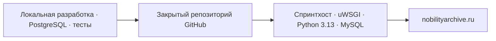

# Развёртывание

Описание обновлено для выпущенного релиза **2.0.1 от 19 ноября 2026 года**:
тег `v2.0.1`, ветка `main`, коммит `214f7d2` закрытого проекта.
Ниже приведён порядок последующих выпусков и требования к обновлению с ранних версий.

## Инфраструктура

| Параметр | Значение |
|---|---|
| Хостинг | «Спринтхост», виртуальный хостинг; ранее описанная конфигурация: 1 ядро, 512 МБ ОЗУ, 1 ГБ диска |
| Веб-сервер | uWSGI, Python 3.13 |
| Фреймворк | Django 5.2.17, зависимости закреплены в requirements-файлах |
| СУБД | MySQL с PyMySQL на хостинге; PostgreSQL локально |
| Конфигурация | `infra/.env`, отдельный для каждой среды, вне git |
| Медиа | Файлы пользователей отдельно от кода и дампа базы |
| Поиск | Доступный для записи временный каталог для SQLite-файлов расширенного поиска |
| Почта | Отправка подтверждений email, кодов входа редакторским ролям и ссылок восстановления пароля |

Код правится локально. Сценарий `infra/deploy/deploy.sh` отказывается работать
при незакоммиченных изменениях на сервере, получает код через `git pull --ff-only`,
ставит зависимости из `requirements-host.txt`, выполняет `check`, показывает план
миграций, предлагает применить его, собирает статику и перезапускает точку входа uWSGI.

## Подготовка версии

1. Зафиксировать код и миграции в закрытом репозитории и выбрать выпускаемый коммит.
2. Запустить проверки Django: `python manage.py test`. Для выбранных изменений
   можно предварительно запускать группы, например `python manage.py test tests.main`.
3. Выполнить регрессионные проверки клиента: `node --test tests/frontend/*.test.cjs`.
   Отдельная браузерная проверка редактора ссылок —
   `node tests/frontend/reference-editor.browser.cjs` (Playwright и Microsoft Edge).
4. Сделать резервные копии рабочей базы и media, проверить восстановление
   в отдельной среде. Для файлов предусмотрены `infra/deploy/backup_media.sh`
   и `infra/deploy/download_media_backup.ps1`.
5. Проверить `python manage.py migrate --plan` на копии базы. Применённые миграции
   не удалять и не исправлять задним числом.

## Миграции при переходе на 2.0

| Изменение | Что учесть перед выпуском |
|---|---|
| Два уровня редакторов (`users.0005`) | Прежние групповые редакторы переводятся в главные редакторы; проверить фактические назначения |
| Архивные фонды (`sources.0004`) | Старое описание переносится в дочерние фонды, затем поле удаляется; проверить неоднозначно разделённые материалы |
| Перенос служителей в `archive_servants` | Переименовываются существующие таблицы с сохранением ID, связей, путей фотографий и типов содержимого; проверить сторонний SQL и права на таблицы |
| Территории и исторические сканы | Существующие подложки переводятся в сканы с точками привязки; устаревшие предложения с импортом файлов нужно отправить заново |
| Коллекции, форум, справочник, настройки разделов | Применить все зависимые миграции и обновить статические файлы |
| Подтверждения email (`users.0012`) | Ранее выданные ссылки становятся недействительными; пользователи могут запросить новые |
| Детали ссылок на фонды (`archive_servants.0005`, `corporations.0004`, `territories.0012`) | Используются существующие таблицы связей, добавляется поле для описи, дела и листов; проверить сохранность привязок |
| Необязательная ссылка на словарь (`reference.0002`) | Термины могут сохраняться без внешней ссылки |

На MySQL изменения схемы не откатываются одной транзакцией: сбой между
переименованиями может оставить частично перенесённую схему. Перенос служителей
нужно отрепетировать на восстановленной MySQL-копии той же версии и конфигурации,
с теми же правами пользователя БД. PostgreSQL-проверка этого не заменяет.
На время переноса остановить web workers и другие процессы записи.
Проверить идентификаторы, количество записей, связанные сведения, права,
личные страницы, предложения и журнал действий. Не переименовывать таблицы вручную
и не подменять выполнение миграций флагом `--fake`.

После переноса старых описаний источников ожидающие предложения с удалённым полем
нужно отправить заново через новый редактор; сохранённые payload остаются справочными.

Миграции `corporations.0003` и `territories.0011` из коммита `190340c` добавляют
источники корпораций, главное фото корпорации и архивные фонды территорий.
Их также нужно применить при выпуске этой версии.

## Обновление с 2.0.0 до 2.0.1

Релиз добавляет две миграции:

- `sources.0006_shared_fund_descriptions` создаёт общие описания фондов
  и необязательные связи с ними. Отдельные записи фондов сохраняются;
  существующие тексты не объединяются автоматически.
- `main.0024_normalize_site_settings_id` нормализует первичный ключ настроек
  в существующих базах, где он ещё автоинкрементный. Это исправляет совместимость
  единственной записи настроек с MySQL. Для новых баз начальная миграция
  уже задаёт явный ключ.

После резервного копирования выполнить обычный просмотр плана и `migrate`,
обновить статику и перезапустить приложение. Проверить сохранение настроек,
общие описания, самостоятельный выбор каждого фонда, поиск и переходы к карточкам.
Удалена ссылка Leaflet на отсутствующий source map; для доставки исправления
тоже нужна обновлённая статика.

При переходе с версии до 2.0.0 дополнительно проверить восстановление пароля:
отправку письма на подтверждённый адрес, срок ссылки один час, смену пароля
и последующий вход редакторской роли с новым почтовым кодом.

## Выпуск и проверка

После успешной репетиции отправить коммит в закрытый репозиторий и выполнить
серверный сценарий выпуска. Для этой версии миграции необходимы: возможность
пропустить их в сценарии не означает совместимость нового кода со старой схемой.
После миграций выполнить `python manage.py collectstatic --noinput` и перезапуск.

Проверить главную и оба поиска, карточки шести разделов, вход с почтовым кодом и восстановление пароля,
доступность закрытых разделов, модерацию, обратную связь, коллекции, фотографии,
карты и форум. Сравнить поведение гостя, пользователя, редактора и главного редактора.
Проверить, что приватные заметки и файлы предложений не открываются посторонним.

Для общих ограничений запросов приложение использует `REMOTE_ADDR`;
доверенный reverse proxy должен передавать туда реальный адрес клиента.
Расширенному поиску необходимы права записи и свободное место во временном каталоге.
Большие и нечёткие запросы требуют нагрузочной проверки на рабочем объёме данных.

## Откат

Откат кода не восстанавливает схему и данные. Базовый путь восстановления —
проверенная резервная копия БД и согласованная с ней версия кода и media.
Не продолжать выпуск после частичного сбоя миграции MySQL до сверки схемы
и истории миграций.

Для успешно завершённого переноса служителей предусмотрен обратный переход
через `python manage.py migrate archive_servants zero` с сохранёнными новыми
миграциями и остановленной записью. Он затрагивает также зависимые миграции
других приложений; перед выполнением нужен просмотр плана и репетиция на копии.
Затем возвращают прежний код. Это не универсальный откат всей ветки.

Обратная миграция фондов собирает старое описание из описаний фондов;
отдельно отредактированные номера и названия не включаются в этот текст.
Для полного восстановления прежних данных нужна резервная копия.

## Диагностика

В закрытом проекте есть диагностическая точка входа uWSGI для поиска ошибок
запуска. После исправления следует вернуть рабочую точку входа.
Секреты, рабочие дампы, личные данные и пользовательские файлы в публичную
витрину не переносятся.
